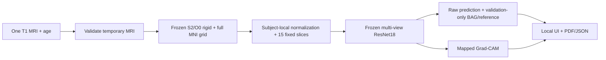

# BrainAge-XAI

**Structural MRI brain-age estimation, research reference context and explainable
model reporting — in a private local workflow.**

BrainAge-XAI is an academic research prototype integrating audited IXI data,
frozen MRI preprocessing, a 2.5D multi-view ResNet18, locked evaluation,
validation-only age-bias correction and Grad-CAM. A shared inference service powers
a local Streamlit application and reproducible CLI, with individual PDF/JSON reports.

**Research only. BAG is not a diagnosis.** The model was trained/evaluated on IXI;
external clinical validity has not been established. Corrected brain age is a
bias-adjusted model estimate, not a medical measurement. There are no diagnostic,
healthy/unhealthy or disease-risk thresholds.

## Accepted scientific evidence

| Item | Accepted result |
|---|---|
| Cohort | 561 eligible subjects; Guys 313 / HH 180 / IOP 68 |
| Subject split | 393 train / 84 validation / 84 locked test |
| Preprocessing | S2/O0 rigid; exact 193×229×193, 1 mm MNI152NLin2009cAsym grid |
| Validation MAE | Axial A: 7.459 years; selected multi-view B: **5.428 years** |
| Locked-test MAE / RMSE / R² | **6.094 years / 7.563 years / 0.796** |
| Overall MAE 95% bootstrap CI | **5.154–7.101 years** |
| Frozen BAG intercept / beta | 5.089670 / −0.122256; validation fit only |
| Corrected test BAG | 0.308 ± 6.742 years; age correlation **−0.279** |

Phase 1/2/3 are final. This integration does not retrain, repeat test evaluation,
change splits, refit correction or reopen model/registration choices. Correction
reduces but does not guarantee age-independence. Zero Grad-CAM maps and
nonbrain/background attribution are known limitations. Small subgroups, scanner/site
confounding, residual rigid correspondence, IOP visibility and single-dataset validity
remain explicit. See the [model card](docs/model-card.md) and
[full academic report](docs/final-project-report.md).

## Pipeline



Age is required for BAG/reference calculations; it is not an MRI model input.
Filename, identity, site and sex do not affect prediction. All 15 slices are selected
once from the public MNI mask extent. No skull stripping, affine/nonlinear
registration, crop/pad or participant-specific slice choice is introduced.

## Install the local application

Use **Python 3.11.17** and run from the repository root:

```sh
python3.11 -m venv .venv
source .venv/bin/activate
python -m pip install -c configs/runtime-constraints.txt -e '.[dev,modeling,app,app-test]'
cp configs/inference.example.yaml configs/inference.local.yaml
```

Check that the interpreter really is 3.11.17. Configure the ignored local YAML with
the accepted checkpoint, correction/reference/slices and pinned MNI T1/mask.
**These private/runtime artifacts are not bundled.** Setup verifies their checksums,
frozen scientific source/configs and software versions. Missing artifacts are an
explicit prerequisite failure, never a reason to train or silently substitute weights.
No dataset/model is downloaded at runtime.

```sh
.venv/bin/python -m streamlit run app/streamlit_app.py
```

Open `http://127.0.0.1:8501`, supply one `.nii`/`.nii.gz` and chronological age,
run analysis, review QC/reference/XAI and explicitly download the report if needed.
The app is loopback-local, with no accounts, database or cloud upload. Detailed
setup, all runtime prerequisites and privacy behavior are in [demo.md](docs/demo.md).

## CLI and programmatic inference

```sh
brainage-infer --input /path/to/new-t1.nii.gz --age 50 \
  --config configs/inference.local.yaml \
  --output artifacts/inference/results/new-analysis
```

The CLI calls the same service as Streamlit and writes PDF, JSON, 15 XAI panels,
raw attribution arrays and provenance/checksums. Output must be new and ignored;
accepted scientific inputs cannot be output destinations. No source MRI or
participant filename is embedded. The Python API is documented in
[demo.md](docs/demo.md#cli-and-programmatic-use).

## Repository guide

```text
app/streamlit_app.py          Local research application
configs/inference.*.yaml      Public runtime contract/example; ignored local paths
configs/runtime-constraints.txt  Verified application/scientific environment
src/brainage_xai/
  data/                      Phase 1 audit, eligibility consumption, saved splits
  preprocessing/             Frozen Phase 2 processing and engineering QC
  registration/              Frozen rigid core and historical study implementations
  modeling/                  Accepted Phase 3 training/evaluation/BAG/Grad-CAM core
  inference/                 Shared single-MRI service, schema, CLI and reports
scripts/fetch_mni_template.py Explicit checksum-pinned template setup
tests/                      Synthetic tests; no real participant fixtures
docs/                       Protocols, measured results and application guides
artifacts/                   Ignored local research/runtime/generated outputs
```

## Reproduce and verify

The [reproducibility guide](docs/reproducibility.md) distinguishes historical study
reproduction from new-MRI inference. Obtain IXI data separately from its
[official source](https://brain-development.org/ixi-dataset/) and honor its terms.
Cloning this repository alone cannot reproduce private-data results. Existing
accepted subject membership and locked-test artifacts must not be regenerated.

```sh
.venv/bin/python -m pytest -q
ruff check .
.venv/bin/python -m compileall -q src app
.venv/bin/python -m pip check
```

Tests use synthetic temporary inputs and do not download weights. A separate
training-subject end-to-end check is technical integration verification only,
not another model evaluation or added performance evidence.

## Privacy and interpretation

MRI, metadata, subject manifests/predictions, weights, private XAI, local configs
and secrets remain ignored. Temporary uploads are removed on normal success/error;
Streamlit results stay in session memory until cleared, and downloads/CLI exports
are explicit. Abrupt termination may require orphan-temp cleanup. Reports use
anonymous analysis IDs, but MRI-derived images remain sensitive. See
[privacy details](docs/demo.md#privacy-and-cleanup).

Research-reference percentiles are not clinical norms. Empirical residual-based
intervals are not clinical confidence intervals and must not be confused with the
overall MAE bootstrap CI. Grad-CAM is attribution, not pathology localization,
causality or diagnosis. External/cognitive-outcome validation, brain masking,
stronger attribution validation and volumetric modeling remain **future work**.

## Academic documentation

- [Final project report](docs/final-project-report.md)
- [Model card](docs/model-card.md)
- [Reproducibility](docs/reproducibility.md) and [local demo/CLI](docs/demo.md)
- [Audit semantics](docs/audit.md)
- [Frozen Phase 2 protocol](docs/preprocessing-frozen.md) and [results](docs/preprocessing-final-results.md)
- [Phase 3 protocol](docs/phase3-modeling.md) and [results](docs/phase3-scientific-ml-results.md)
- [Application validation](docs/application-validation.md)
- [Changelog](CHANGELOG.md) and [release notes draft](docs/release-notes-draft.md)

Package version remains 0.1.0 for frozen environment compatibility; local integration
metadata is 0.1.0-local. No release/tag or new license is introduced by this work.
